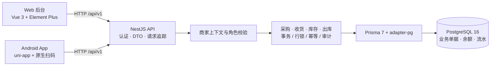

# 采仓管家——电商采购与仓储管理系统

面向“电商平台采购 → 自有仓库收货 → 库存管理 → 出库发货”的多商家管理系统。电脑 Web 负责建档、采购和对账，Android 手机负责扫码查询与仓库作业，业务数据统一保存在 PostgreSQL。

项目源于多平台、多采购账号的日常采购需求：采购记录分散、包裹分批到货、实际成本难核对，重复提交还可能造成库存错误。采仓管家将采购账号、订单、包裹、收货和库存流水串联起来，让每次入出库和每笔采购成本都有来源可查。

**当前状态：**核心业务及采购对账已实现；Android 测试 APK 已按用户确认范围完成核心验收；生产配置已完成隔离环境演练，尚未公网正式上线。

[快速启动](#快速启动) · [系统架构](#系统架构) · [项目演示](#项目演示) · [测试与完成状态](#测试与完成状态) · [技术文档](#技术文档)

## 核心功能

| 业务           | 已实现能力                                                                                  |
| -------------- | ------------------------------------------------------------------------------------------- |
| 工作空间与权限 | 多商家隔离，OWNER / ADMIN / BUYER / WAREHOUSE / VIEWER 五种角色，注册、登录、令牌刷新与退出 |
| 商品与仓库     | 货号、颜色、尺码、商家内唯一 SKU；商品搜索、编辑、停用及多仓库管理；商品条码可选            |
| 采购账号与订单 | 淘宝、京东、拼多多等账号别名；多 SKU 草稿、确认下单、实际单价、优惠与运费、历史价格快照     |
| 包裹与扫码收货 | 一采购单多包裹、一包裹多 SKU；前导零运单、多承运商候选、部分收货与防重复入库                |
| 库存与出库     | 按仓库和 SKU 查询余额、移动加权平均成本、可追溯流水、盘盈盘亏及草稿出库/确认发货            |
| 供应商采购退货 | 关联原采购及入库来源、部分退货、可退量与库存检查，退款登记与库存成本分别记录                |
| 统计与采购对账 | 按账号、平台、日期、货号/SKU筛选；采购、待入库、库存、出库、退货分别统计；安全 CSV 导出     |

运单扫码只用于找到包裹，仓管仍须核对实际 SKU 和数量后确认入库。系统不自动抓取个人电商订单，也不保存第三方平台登录密码。

## 系统架构

采用 pnpm Monorepo、模块化单体 API 和两个客户端，共用真实数据库与服务端业务规则。



生产配置由 Caddy 提供 Web 静态资源、HTTPS 和 API 反向代理，数据库使用内部网络与持久化卷。该配置已在独立容器环境验证；图中的客户端与 API 不代表已有正式公网服务。

| 层次       | 当前技术栈                                                                                      |
| ---------- | ----------------------------------------------------------------------------------------------- |
| Web        | Vue 3.5.44、TypeScript、Vite 8.3.4、Element Plus 2.14.7、Pinia、Vue Router                      |
| Android    | uni-app Vue 3.4.21、TypeScript、锁定 DCloud 编译器、HBuilderX / Barcode 模块                    |
| API        | NestJS 12.1.3、Prisma 7.10.0、@prisma/adapter-pg、JWT、Swagger / OpenAPI                        |
| 数据与成本 | PostgreSQL 16.15、UUID、NUMERIC / Decimal、Prisma Migrate                                       |
| 工程与部署 | pnpm workspace、TypeScript strict、ESLint、Prettier、Node.js Test Runner、Docker Compose、Caddy |

值得关注的工程实现：

- **库存一致性：**收货、出库、调整和采购退货均由服务端事务更新余额、流水和审计；行锁与幂等操作号防止并发超收、超卖或重复扣减。
- **成本可追溯：**采购明细独立保存实际单价，确认后冻结；商品参考价变更不覆盖历史成本。金额使用精确数值计算，退款与库存成本分开核算。
- **多商家安全：**请求中的工作空间须经成员关系验证，资源查询限定租户，角色权限与数据库复合外键共同约束关联。
- **真实验证：**业务测试连接隔离 PostgreSQL；部署演练执行真实 TLS、重启持久化、备份和恢复，不以脚本生成代替验收。

## 项目演示

以下为真实页面截图的预留位置，**目前尚未补图**。截图请使用独立演示商家数据，按[截图指南](docs/screenshots/README.md)保存，不使用生成图片冒充界面。

| 页面               | 建议展示内容                                  | 预留图片路径                             |
| ------------------ | --------------------------------------------- | ---------------------------------------- |
| 商品管理           | 货号、颜色、尺码、SKU、参考价及状态           | `docs/screenshots/products.png`          |
| 采购订单           | 采购账号、多 SKU 明细、优惠、运费和服务器合计 | `docs/screenshots/purchase-order.png`    |
| Android 扫码入库   | 真机扫码后的包裹与收货明细                    | `docs/screenshots/android-receiving.png` |
| 库存管理           | 分仓 SKU 数量、平均成本和账面成本             | `docs/screenshots/inventory.png`         |
| 数据统计与采购对账 | 账号/日期筛选、金额卡片和对账明细             | `docs/screenshots/reconciliation.png`    |

<!-- 真实图片放到上述路径并检查脱敏后，再取消对应图片行的注释。


-->

## 快速启动

已验证的本地路线为 Windows + PowerShell + Docker Desktop（WSL2）。需要 Git、Node.js `>=22.13.0 <23` 和锁定的 pnpm `11.25.0`；任务36实际使用 Node.js 22.22.2。Android 真机运行和 APK 打包另需 HBuilderX、官方插件及已授权设备，Web/API 开发无需先连接手机。

首次获取可执行 `git clone https://github.com/Zhangyulong12/caicang-manager.git`。已有项目直接进入根目录，无需重新克隆或安装已有工具。

终端一，启动数据库并运行 API：

```powershell
cd D:\Dev\caicang-manager
pnpm install --frozen-lockfile
pnpm db:up
pnpm prisma:migrate:deploy
pnpm prisma:migrate:status
pnpm prisma:generate
pnpm start:api
```

首次 `pnpm db:up` 只在缺少 `.env` 时生成随机开发数据库凭据，已有配置会保留。新电脑可调整上面的工作目录；已有数据卷必须使用匹配的原始凭据。初始化使用现有迁移，**不要重复导入 `database/schema.sql`、重置数据库或删除卷**。详细说明见[本地数据库](docs/LOCAL_DATABASE.md)。

终端二，启动 Web：

```powershell
cd D:\Dev\caicang-manager
pnpm dev:web
# 可选：检查真实数据库连接
Invoke-RestMethod http://127.0.0.1:3000/api/v1/health
```

| 入口         | 本地开发地址                        |
| ------------ | ----------------------------------- |
| Web 后台     | http://127.0.0.1:5173               |
| API 健康检查 | http://127.0.0.1:3000/api/v1/health |
| Swagger      | http://127.0.0.1:3000/api/docs      |
| 采购对账     | http://127.0.0.1:5173/reports       |

在 Web 注册自己的开发账号，创建或选择商家后添加商品、采购账号与采购单。无需使用写在 README 中的固定密码或 Token。停止 API/Web 使用各终端 Ctrl+C；`pnpm db:stop` 停止数据库并保留数据。

Android 使用电脑的可访问局域网 IPv4，手机上的 localhost 不能指向电脑。[手机端说明](docs/MOBILE_APP.md)包含配置、HBuilderX 导入和签名步骤；资源构建不等于生成 APK。正式 HTTPS 地址、生产独立配置及恢复流程见[生产部署指南](docs/PRODUCTION_DEPLOYMENT.md)，测试 APK 的局域网地址不能作为正式服务地址。

## 测试与完成状态

以下是 **2026-10-30 任务36实际执行记录**，不是本次文档修改重新运行的业务测试。每个命令均为 0 失败、0 跳过；不同命令的用例有重叠，不相加作为独立覆盖总数。

| 命令                                                 | 通过数量 / 结果                                 |
| ---------------------------------------------------- | ----------------------------------------------- |
| `pnpm test`                                          | 744；含共享包、API、Web、mobile H5 构建         |
| `pnpm test:models`                                   | 66；迁移、重复 seed、约束及结构漂移             |
| `node --test scripts/registration.test.mjs`          | 8；真实 Web 代理注册与权限边界                  |
| `pnpm test:production`                               | 13；隔离生产配置、TLS、数据库重启及真实备份恢复 |
| `pnpm typecheck` / `pnpm lint` / `pnpm format:check` | 通过                                            |
| `pnpm --filter @caicang/mobile build:app`            | APP 资源构建通过，未生成新签名 APK              |

自动化涵盖金额、库存事务回滚、并发/重复请求、角色、商家隔离及 CSV 的 BOM/特殊字符/公式防护。Web 测试主要验证客户端逻辑和真实 API，不等于浏览器全页面点击测试；Node 中的扫码逻辑测试也不等于相机验收。

| 阶段                     | 实际完成程度                                             | 验收依据                             |
| ------------------------ | -------------------------------------------------------- | ------------------------------------ |
| 任务33：统计与采购对账   | 已完成                                                   | [任务33报告](docs/TASK_33_REPORT.md) |
| 任务34：Android 测试 APK | 已按用户确认范围完成核心验收                             | [任务34报告](docs/TASK_34_REPORT.md) |
| 任务35：安全与生产准备   | 安全修复、生产配置和隔离环境验收已完成；尚未正式公网部署 | [任务35报告](docs/TASK_35_REPORT.md) |
| 任务36：最终回归         | 已完成最终回归与文档整理，保留未验收项                   | [任务36报告](docs/TASK_36_REPORT.md) |

仍需完成的工作和限制：

- 独立 APK 的相机拒绝/恢复、手输兜底、未知码、断网恢复追加测试尚未执行，最终确认按钮快速双击未单独人工确认。任务35会话/租户缓存安全修复尚未打入旧测试 APK，需要新包真机复验。
- 任务35依赖公告快照仍有移动端/工具链告警（高13、中23、低6、严重0），不是全仓零漏洞；未做镜像 OS 漏洞扫描或正式容量压测。
- 正式服务器、域名、证书、签名发布与公网业务联调尚未验收；生产默认关闭公开注册，邮箱归属验证方案待确定。异地加密备份、定时备份与正式容量恢复目标仍待验证。

## 技术文档

| 想了解什么         | 文档                                                                                                                                                                                        |
| ------------------ | ------------------------------------------------------------------------------------------------------------------------------------------------------------------------------------------- |
| 业务边界与系统设计 | [项目规格](docs/PROJECT_SPEC.md) · [架构](docs/ARCHITECTURE.md) · [技术决策](docs/DECISIONS.md)                                                                                             |
| 数据库与接口       | [数据库设计](docs/DATABASE_DESIGN.md) · [API / OpenAPI](docs/API_SPEC.md) · [商家授权](docs/TENANT_AUTHORIZATION.md)                                                                        |
| 成本与仓库流程     | [采购账号](docs/PURCHASE_ACCOUNTS.md) · [扫码流程](docs/SCAN_FLOW.md) · [库存调整](docs/ADJUSTMENTS.md) · [采购退货](docs/PURCHASE_RETURNS.md) · [统计口径](docs/REPORTS.md)                |
| 运行与部署         | [本地数据库](docs/LOCAL_DATABASE.md) · [Android](docs/MOBILE_APP.md) · [生产部署 / 备份恢复](docs/PRODUCTION_DEPLOYMENT.md) · [安全审计](docs/SECURITY_AUDIT.md)                            |
| 项目记录与展示维护 | [最终验收](docs/TASK_36_REPORT.md) · [任务清单](docs/CODEX_TASKS.md) · [历史 README](docs/README_HISTORY.md) · [截图指南](docs/screenshots/README.md) · [About 操作](docs/GITHUB_REVIEW.md) |

源码分布：`apps/admin-web`（Web）、`apps/mobile`（Android）、`apps/api`（API / Prisma）、`packages`（共享契约和工具）、`infra/production`（生产配置）、`scripts`（Windows 与验收脚本）。逐任务开发过程保留在 `docs/TASK_*_REPORT.md` 和历史 README 中。
