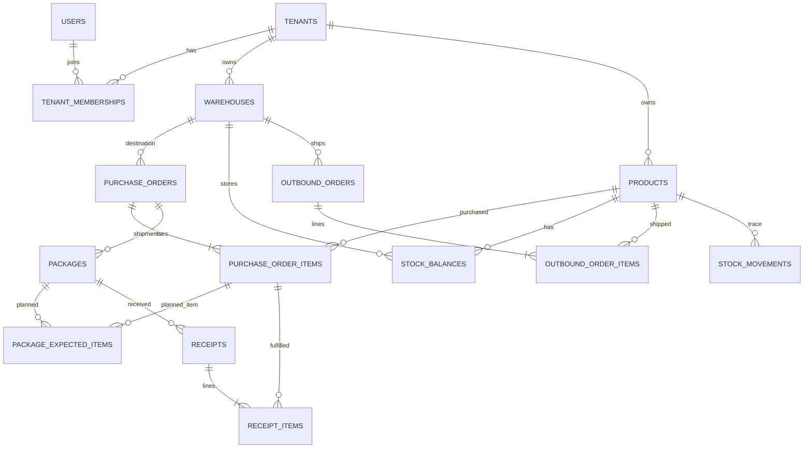

# 数据库设计（PostgreSQL）

可执行建表参考：`../database/schema.sql`。本文件解释表之间的关系、业务约束、成本计算和事务实现要求。schema 是初稿，编码时以 Prisma Migrate 产生可追踪 migration；不能在已有真实数据库直接重放 SQL。

任务 03 已建立 `apps/api/prisma/schema.prisma` 与 `20261015012323_initial_business_models` 初始迁移；以下实施补充以迁移为准，参考 SQL 原件保留。启动与验证见 `TASK_03_REPORT.md`。

## 任务 03 实施补充

任务 05 补充：新增追踪迁移 `20261015090000_unique_normalized_user_email`，在 users 上创建 `lower(btrim(email))` 表达式唯一索引。保留原 email 值和原唯一约束，不改写既有用户；应用前若已有规范化重复邮箱则迁移会失败，必须显式处理，不自动合并或删除。新注册保存规范化邮箱，登录使用同一表达式的参数化查询；索引因 Prisma 模型无法表达函数索引，由 SQL 迁移管理。没有新增业务表、修改库存字段或重放参考 SQL。

- `tenants` 是租户根，`users` 是跨商家的全局账号，因此不增加循环 tenant_id；其余 15 张表均有非空 tenant_id 和租户外键。同一账号通过 memberships 关联多个商家。
- 所有模型有 UUID 主键、created_at/updated_at（timestamptz）。补齐参考稿缺失的时间字段；Prisma @updatedAt 与迁移内 PostgreSQL BEFORE UPDATE 触发器共同覆盖 ORM 和 SQL 写入。时间字段不意味着可编辑历史入库、库存流水或审计记录。
- 所有租户业务关系采用复合外键和 Restrict 删除/更新；操作者关联 `(tenant_id,user_id)` membership，进一步防止无商家成员身份的操作记录。任务 07 的认证/商家/角色守卫与事务服务同时验证用户启用、active membership 与权限，外键本身不代替授权。
- 包裹预计行与入库行增加 purchase_order_id。复合外键保证预计行和包裹同订单、收货单和包裹同订单、收货仓库和采购单相同、入库行产品与采购行相同。
- 价格/折扣/运费为 NUMERIC(18,2)，单位及总库存成本统一 NUMERIC(20,4)，遵循本设计的成本精度口径，扩展参考 SQL 的部分 NUMERIC(18,4) 字段。
- 保留参考稿全部 31 个 CHECK，额外拒绝全空格 SKU。状态字段保留 VARCHAR + CHECK；CHECK 与时间触发器由版本化 SQL 管理，未来迁移须保留并审阅。
- 商品非空条码、承运商+运单号的唯一性用普通 nullable UNIQUE 表达：PostgreSQL 默认 NULLS DISTINCT 允许多个 NULL，与参考稿部分唯一索引的业务规则一致。运单查询用租户+运单索引，保留原订单、库存、流水与审计查询索引。
- source_item_id（库存流水多态来源）及 audit_logs.object_id（多态审计对象）沿用参考设计。无法用单一外键指向多张表，必须在后续事务服务中做租户、SKU、仓库及来源真实性验证。本次没有开放业务写接口。
- 超收/预计总量、状态转换、库存余额与流水原子一致性仍属后续业务事务职责。本次仅验证数据库模型和数据库约束，不能将这些验证当作完整库存流程或权限验收。

## 1. 核心实体及关联

## 2. 表清单（17 张业务表）

|表|主要用途|关键约束|
|---|---|---|
|tenants|商家/租户|tenant UUID|
|users|平台登录用户|email 全局唯一、密码只存哈希|
|tenant_memberships|用户归属与角色|tenant_id+user_id 唯一|
|warehouses|仓库|tenant_id+code 唯一|
|products|SKU 主数据|tenant_id+sku 唯一，非空条码商家内唯一|
|purchase_orders|采购主单|tenant_id+order_no 唯一，状态机|
|purchase_order_items|采购行|qty>0，不能重复 SKU|
|packages|包裹与运单|tenant+carrier+tracking 唯一，按 tracking 索引|
|package_expected_items|包裹预计 SKU 数量|同包裹同采购行唯一|
|receipts|验收入库单|tenant+client_operation_id 唯一，支持部分收货|
|receipt_items|验收入库行|实际验收数量、成本快照|
|stock_balances|仓库/SKU 现存数量成本|tenant+warehouse+SKU 唯一，非负|
|outbound_orders|发货出库主单|唯一单号、确认操作 UUID|
|outbound_order_items|出库 SKU 明细|数量>0、成本快照|
|stock_adjustments|经授权的库存调整|原因、数量增减、操作 UUID|
|stock_movements|不可变库存流水|来源类型+来源明细唯一、前后数量校验|
|audit_logs|重要业务行为审计|按租户与时间索引|

## 3. 字段/类型共识

- PK 使用 UUID；记录应带 `tenant_id`，跨表访问校验当前商家归属。
- 所有数量使用 INTEGER 正数；V1 SKU 以整件计，不支持公斤/散装小数库存。
- 价格、折扣、运费使用 `NUMERIC(18,2)`；库存成本使用 `NUMERIC(20,4)`；API 金额 JSON 用字符串，例如 `"18.50"`。
- `created_at`/`updated_at` 用 UTC 存储，前端按用户时区展示。
- 地址与手机号码为个人信息，访问权限和日志脱敏；不在业务日志中打印完整内容。
- 商品停用保留历史单据，不级联删除历史流水。

## 4. 防止脏数据的规则

1. 所有数据列表查询强制 `tenant_id` 过滤；具体对象读取要同时按 `id + tenant_id` 过滤，外键也尽量采用 `(tenant_id,id)` 复合约束。
2. `purchase_order_items.product_id` 所属租户必须等于采购单租户。
3. `package_expected_items.purchase_order_item_id` 必须属于 `packages.purchase_order_id`；多包裹预计 SKU 总量不得高于采购行订购量。
4. `receipt_items.purchase_order_item_id` 必须来自对应收货单所属采购单，产品必须与采购行一致。
5. 同一采购行全部 `receipt_items.quantity` 累计不得高于 `purchase_order_items.quantity`；在事务中锁定采购主单再检查，严禁先查后写导致竞态。
6. 无预计包裹行的包裹需要显式完成收货，不可根据订单剩余数量猜测包裹已完结。同一包裹的包裹行若已指定预计数量，原则上限制该包裹该 SKU 入库累计不超过预计数量；若需改动包裹装箱清单，要求 Buyer/Admin 先审批修正计划，不能悄悄放开。
7. 重复 `clientOperationId` 对同一租户返回原收货单；相同 ID 不同请求体通过 `request_hash` 必须拒绝。
8. 发货用库存余额行锁/条件更新确保 `quantity_on_hand >= need`；无余额行视作零。
9. 所有入库、出库与库存调整都必须在**同一数据库事务**中生成业务单据、库存余额变更、库存流水与审计日志；失败整体回滚。

## 5. 成本核算口径

V1 币种人民币。确认采购时计算：

`line_net = quantity × unit_price - discount_amount`

`order_payable = Σ line_net + freight_amount`

按各采购行 `line_net / Σline_net` 的占比分配整单运费，最后一行吸收尾差；若全部行净价为 0，则按件数比例分配。每行 `landed_unit_cost = (line_net + freight_allocated) / quantity`（存四位小数，保留原订单分摊来源避免汇总偏差）。

库存采用**移动加权平均成本法**：

- 入库：`new_qty = old_qty + qty_in`；`new_cost = old_cost + qty_in × landed_unit_cost`。
- 出库：`avg = old_total_cost / old_qty`；`out_cost = qty_out × avg`；`new_cost = old_cost - out_cost`；若数量清零，成本归零并把极小尾差归入最后一笔出库。
- 库存总额与账面平均成本均以后端数据库 `Decimal` 精确计算，禁止 JS Number 浮点直接记账。
- 采购订单金额与“当前库存价值”是不同指标：售出/出库后库存价值下降，原采购支出不会下降。

## 6. 并发实现建议

入库：`BEGIN` → 按 `(tenant,id)` 锁采购主单（同一采购单收货串行化）→ 按 `(tenant,id)` 锁包裹 → 查询历史已收/验证剩余 → 创建 receipts 和 items（幂等唯一键）→ 对 `stock_balances` 按 warehouseId+productId 排序加锁并 upsert → 写 stock_movements → 更新单据状态 → 审计 → COMMIT。使用 `SELECT ... FOR UPDATE` 原生 SQL 或等价事务锁，确保同一订单全渠道并发受控。

出库：`BEGIN` → 锁出库单 → 验证 status=DRAFT → 以 SKU 稳定排序锁余额行 → 校验/扣减库存 → 保存 outbound_item unit cost → 写流水 → 标记 SHIPPED 和 confirm_operation_id → 审计 → COMMIT。

库存余额的 `(tenant_id, warehouse_id, product_id)` 唯一索引与事务是最终正确性的关键。所有重试行为严格限定为可识别的幂等操作，不可盲目重复扣增。

## 任务 06：全局登录会话与刷新凭据

在原 17 张业务/身份表之外，追踪迁移 `20261017090000_auth_refresh_sessions` 新增两张认证基础表。它们与 users 一样是全局账号身份基础设施，不持有商家业务数据，不带 tenant_id；原有 15 张租户业务表隔离规则保持不变。`database/schema.sql` 保留为原始参考，不含本任务认证表，禁止作为初始化脚本叠加执行。

|表|字段及约束|用途|
|---|---|---|
|auth_sessions|UUID id、user_id 外键、expires_at、revoked_at、created_at/updated_at；user/revoked 和 expiry 索引|每次登录独立会话；过期或撤销时拒绝 Access/Refresh|
|refresh_tokens|UUID id、session_id 外键、token_hash VARCHAR(64) 唯一并校验小写 hex、used_at、created_at/updated_at；session 索引|保存随机凭据的 SHA-256 摘要；已用行保留以检测重放|

两个外键在删除账号/会话时级联删除其认证凭据，不影响原业务外键的 Restrict。更新时间有数据库触发器。会话绝对有效期在登录时确定，刷新不延长。Refresh Token 原文只在签发时返回；不保存 Token 原文、地址、IP、UA 或签名密钥。

refresh/logout 都在事务内按 session id 执行 SELECT FOR UPDATE，随后重新读取凭据消费与会话状态，解决跨 API 进程并发。一次消费与新凭据入库原子提交；旧凭据重放先提交会话撤销，再在事务外返回标准 401，避免异常回滚撤销。退出同样锁会话且不覆盖已有 revoked_at。后续请求校验 JWT sid 与账号绑定并查询会话状态。

本次不自动删除任何已有数据，也未增加清理定时任务。已用哈希应至少保留到会话到期，后续可在会话到期后按 expires_at 分批归档/清理；清理流程需另行授权与测试。

## 任务 07：组织与授权的运行规则

不新增表或迁移。创建商家同一事务插入 tenants、创建者 OWNER membership、code=DEFAULT 的 warehouses 和 TENANT_CREATED audit。tenant_memberships 的 tenant_id+user_id 唯一性处理重复加入，tenant_id+id 用于限定修改对象；所有成员变更和成功审计同事务。

读商家/成员列表先锁 tenants 根行 FOR SHARE；成员写入 FOR UPDATE，随后重新检查 actor 的用户启用、active membership 与角色。OWNER 不可通过普通成员 API 授予/修改/停用；ADMIN 只能管理普通三类角色。权限 before/after 与 requestId 保存至 audit_logs.metadata，不保存邮箱/Token/密码或请求正文。相同 PATCH 无变化时不更新、不新增审计；不物理删除成员以保留历史操作者外键。

## 任务 08：商品参考价与备注

增量迁移 `20261017093000_product_reference_price_remark` 为 products 新增 nullable reference_purchase_price NUMERIC(18,2)、remark TEXT；不更新原商品、订单或库存记录。新增 ck_product_reference_price 保证非负且有限（含拒绝 NaN），ck_product_remark_length 限制备注 2000 字符；idx_product_tenant_active_time(tenant_id,is_active,created_at DESC,id DESC) 支持启用筛选与稳定分页。旧的 SKU/非空条码唯一索引保持，API 把空条码归 null，不改写已有编码。

参考价未知为 null、免费为 0.00；API 仅接受不超过两位小数的十进制字符串，通过 Prisma.Decimal 保存与固定两位格式返回，防止数据库舍入掩盖输入错误。商品参考价不是真实采购成交价，不更新 purchase_order_items.unit_price/discount_amount/landed_unit_cost，也不写库存成本。停用保留原行和所有历史外键，SKU/条码继续占用，接口不开放删除。

创建和实际修改与 PRODUCT_CREATED/PRODUCT_UPDATED 审计同事务，复用租户根锁与权限复查。SQL 参考稿保留原样、不含本次两列，以 Prisma 迁移为可执行源，不叠加导入参考 SQL。

## 7. 索引与历史数据

任务 09 的第五个迁移 `20261020090000_warehouse_remark` 只给 warehouses 新增 nullable remark TEXT 和 ck_warehouse_remark_length（2000 字符），原地址、时间、唯一索引和历史关联均保留。默认仓库继续由创建商家事务写入。仓库编码使用 (tenant_id,code) 唯一键；采购单 warehouse_id 非空并以 (tenant_id,warehouse_id) 关联仓库；库存余额按 (tenant_id,warehouse_id,product_id) 唯一。同商家跨仓同 SKU 可以分别存在，跨商家仓库关联由复合外键拒绝。历史单据和库存对仓库的 Restrict 阻止物理删除，API 不提供删除或调拨。

已有联合索引：采购状态时间、包裹运单、库存 SKU、流水 SKU/时间、出库状态、审计时间。未来可扩充分区/归档，但 V1 不需要。禁止物理删除有采购/库存流水的商品和订单；取消单据用状态机表示。
