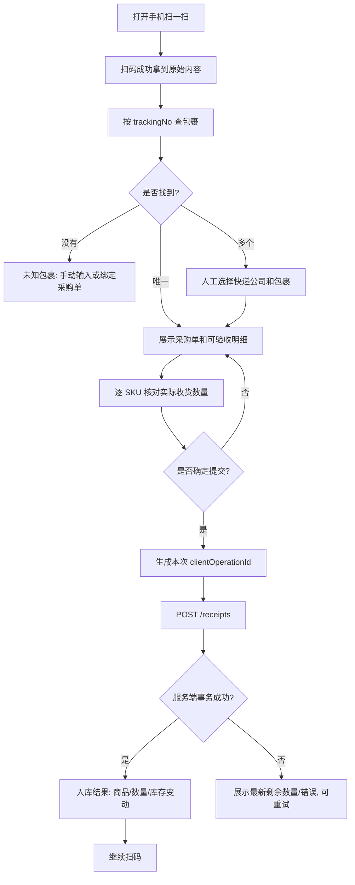

# 扫码入库设计：Android 真机 + 后端事务

## 1. 两套码，两个业务动作

- 包裹运单条形码：用于从 `packages` 反查采购单；**无法自动推断包裹中包含哪个 SKU**。
- SKU 商品码：用于查 `products`、查询库存、选出库商品。没有条形码可以打印系统生成的 SKU 码。
- 首版相机扫描使用 `uni.scanCode({ onlyFromCamera: true, scanType: ['barCode','qrCode'] })`；浏览器 H5 不支持此调用；Android APK 必须真实设备验证。官方：https://uniapp.dcloud.net.cn/api/system/barcode

## 2. 页面与状态

`待扫描 IDLE` → `扫描 SCANNING` → `按码查找 LOOKUP` → `匹配 MATCHED / 多候选 CHOOSE / 未知包裹 UNKNOWN` → `展示商品 CHECKING` → `提交 RECEIVING` → `成功 SUCCESS / 校验失败 ERROR`。

流程：



## 3. Android 扫码示例（伪接入，可交给 Codex 改成实际 .vue 页面）

```ts
function scanPackage() {
  uni.scanCode({
    onlyFromCamera: true,
    scanType: ['barCode', 'qrCode'],
    success: async (result) => {
      const trackingNo = result.result.trim();
      if (!trackingNo || trackingNo.length > 128) {
        uni.showToast({ title: '条码内容无效', icon: 'none' });
        return;
      }
      // API client automatically adds Authorization + X-Tenant-Id
      // GET /api/v1/packages/lookup?trackingNo=<urlencoded>
      await lookupPackage(trackingNo);
    },
    fail: () => { /* 用户取消: 静默返回; 权限拒绝: 提示设置权限或手动输入 */ }
  });
}
```

不要把扫码结果直接当成采购单 ID 或 SKU ID。运单可能以 0 开头，必须作为字符串处理。不要猜承运商或擅自移除特殊字符；若某平台二维码携带 URL，先做安全校验，仅允许识别明确的运单码格式，剩余转手动输入。

## 4. 前端防重复触发

- 扫码时 `isScanning` 锁按钮；请求中 `isSubmitting` 锁提交按钮。
- `clientOperationId` 在“用户第一次点确认”时生成一次；网络超时或用户重试同一提交，必须复用相同 UUID/相同 payload，直到服务器确定结果；重新编辑数量后生成新的 UUID。
- 连续扫码时只有收到成功/错误页面后才允许下一次扫描；用声音/震动反馈，不可仅以震动代表数据库成功。
- 断网时显示“未提交/待重试”，不把库存加到本地；V1 不提供离线正式记账。

## 5. 服务端事务伪代码

```ts
async function confirmReceipt(ctx, input) {
  return db.transaction(async (tx) => {
    // 0. Validate membership/role and UUID. Same clientOperationId:
    //    if same payload => return prior receipt, else 409.
    // 1. Lock parent purchase_order row by tenant_id/id (SELECT ... FOR UPDATE).
    // 2. Lock package row; ensure package belongs to this purchase order and tenant.
    // 3. Validate status != CANCELLED/DRAFT, input items belong to order.
    // 4. Query SUM(receipt_items.qty) per purchase_order_item across ALL packages.
    // 5. Ensure receivedTotal + newQty <= orderedQty for each line.
    //    If expected package quantities exist, enforce package remaining as well.
    // 6. Create immutable receipt and receipt_items with unique client_operation_id.
    // 7. In sorted product ID order, lock/upsert stock balance and write stock movements.
    // 8. Update purchase order states from aggregate actual receipts; package with known expected lines may auto-complete at expected quantity; otherwise operator must explicitly close package receiving.
    // 9. Insert audit_log then commit. Rollback everything on any failure.
  });
}
```

如果事务并发发生唯一键冲突，应该重读 `clientOperationId` 原结果；如果是其他业务冲突，不能误报成功。`stock_movements` 根据 `source_type+source_line_id` 有唯一约束作二次保险。

## 6. 必测异常

1. 未找到运单；码不完整；相同号码不同快递公司。
2. 采购单尚未确认下单；采购单取消；包裹已全部收货。
3. 同个 SKU 在两个包裹重复收，累计超采购量。
4. 网络重试、重复点击、扫码页面自动重新进入；服务端同时收到重复入库请求。
5. 相机拒权、模糊光照、条码识别慢、扫描非运单二维码。
6. 人工录入、部分到货、缺货、错货、包装破损，要求备注和异常状态。
7. 收货期间采购单/包装预计件数发生修改，必须有状态控制和锁。

## 7. 最小 Android 验收

使用真实 APK 安装到两种不同品牌/型号 Android 手机，至少测试 CODE128、二维码、中文提示、弱网、相机授权/拒绝、连续扫描、手输模式、重复确认和服务器更新实时性。不能将电脑模拟器上的扫码成功替代真机验收。
